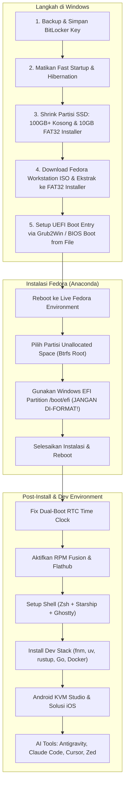

# Panduan Lengkap Dual-Boot Fedora (GNOME) + Windows Tanpa USB & Ultimate SWE Dev Setup

Dokumen ini adalah panduan komprehensif dari nol hingga tuntas untuk melakukan dual-boot **Fedora Workstation (GNOME)** berdampingan dengan Windows **tanpa menggunakan flashdisk USB**, serta mengonfigurasi seluruh ekosistem Software Engineering (SWE) modern berstandar industri.

---

## 📑 Daftar Isi

1. [Arsitektur & Peta Alur Instalasi](#1-arsitektur--peta-alur-instalasi)
2. [Fase 1: Persiapan Kritis di Windows (Wajib Jangan Dilewati)](#2-fase-1-persiapan-kritis-di-windows-wajib-jangan-dilewati)
3. [Fase 2: Instalasi Fedora Tanpa USB Flashdrive](#3-fase-2-instalasi-fedora-tanpa-usb-flashdrive)
4. [Fase 3: Post-Installation Fixes (Wajib Hari Pertama)](#4-fase-3-post-installation-fixes-wajib-hari-pertama)
5. [Fase 4: Modern Terminal & Shell Experience](#5-fase-4-modern-terminal--shell-experience)
6. [Fase 5: Full-Stack Programming Languages & Tooling](#6-fase-5-full-stack-programming-languages--tooling)
7. [Fase 6: Containerization (Docker vs Podman)](#7-fase-6-containerization-docker-vs-podman)
8. [Fase 7: Mobile Development Setup (Android KVM & Realitas iOS)](#8-fase-7-mobile-development-setup-android-kvm--realitas-ios)
9. [Fase 8: AI Coding Assistants & Modern Editors](#9-fase-8-ai-coding-assistants--modern-editors)
10. [Bonus: One-Shot Fedora SWE Bootstrap Script](#10-bonus-one-shot-fedora-swe-bootstrap-script)

---

## 1. Arsitektur & Peta Alur Instalasi



---

## 2. Fase 1: Persiapan Kritis di Windows (Wajib Jangan Dilewati)

Sebelum menyentuh partisi atau bootloader, Windows harus dipersiapkan agar tidak mengunci hard drive (hibernation lock) atau memblokir instalasi.

### 2.1. Cek & Amankan Kunci BitLocker

> [!CAUTION]
> **SANGAT KRUSIAL**: Jika BitLocker aktif di Windows, mengubah partisi atau bootloader akan memicu **BitLocker Recovery Screen** saat booting Windows. Anda **WAJIB** menyimpan 48-digit Recovery Key sekarang!

1. Buka PowerShell atau Command Prompt (Administrator) di Windows:
   ```powershell
   manage-bde -status
   ```
2. Jika statusnya `Protection On`:
   - Buka **Control Panel** -> **BitLocker Drive Encryption**.
   - Klik **Back up your recovery key** -> Simpan ke akun Microsoft Anda, simpan ke file teks di HP/cloud, atau cetak.
   - *(Alternatif jika tidak ingin ribet)*: Klik **Turn off BitLocker** atau `manage-bde -protectors -disable C:`.

### 2.2. Matikan Windows Fast Startup & Hibernation

Windows "Fast Startup" membuat sistem berada dalam mode hybrid-hibernation saat shut down. Ini mengunci filesystem NTFS menjadi read-only bagi Linux dan dapat merusak filesystem jika diakses.

1. Buka PowerShell (Administrator), jalankan:
   ```powershell
   powercfg /h off
   ```
2. Verifikasi di Control Panel:
   - Masuk ke **Control Panel** -> **Hardware and Sound** -> **Power Options**.
   - Klik *Choose what the power buttons do*.
   - Klik *Change settings that are currently unavailable*.
   - Pastikan centang **Turn on fast startup (recommended)** sudah MATI/hilang.

### 2.3. Verifikasi Mode Partisi (Harus GPT & UEFI)

Dual-boot modern mewajibkan sistem berbasis **UEFI** dan skema partisi **GPT**.
1. Tekan `Win + R`, ketik `msinfo32`, tekan Enter.
2. Cek baris **BIOS Mode**: Pastikan tertulis **UEFI** (bukan Legacy).
3. Buka PowerShell, ketik:
   ```powershell
   Get-Disk | Select-Object Number, FriendlyName, PartitionStyle
   ```
   Pastikan `PartitionStyle` adalah **GPT**.

### 2.4. Alokasikan Ruang Partisi (Shrink Volume)

Kita butuh 2 ruang kosong:
- **Installer Partition**: ~10 GB (untuk menaruh file ISO instalasi Fedora pengganti USB).
- **Linux Free Space**: 100 GB – 200 GB+ (ruang kosong tanpa format untuk OS Fedora dan file dev Anda).

Langkah di Windows:
1. Tekan `Win + X`, pilih **Disk Management** (`diskmgmt.msc`).
2. Klik kanan pada partisi `C:` (atau partisi data `D:` yang lega), pilih **Shrink Volume...**.
3. **Langkah A (Buat Installer)**:
   - Shrink sebesar `10240` MB (10 GB).
   - Di ruang unallocated 10 GB yang baru muncul: Klik kanan -> **New Simple Volume**.
   - Format dengan filesystem: **FAT32** (Catatan: beri label `FEDORA_INST`).
   - Beri drive letter, misalnya `Z:`.
4. **Langkah B (Buat Ruang Kosong untuk Fedora)**:
   - Klik kanan lagi pada partisi `C:`/`D:`, pilih **Shrink Volume...**.
   - Masukkan kapasitas yang ingin Anda berikan untuk Fedora (minimal `80000` MB / ~80 GB, rekomendasi `120000` MB - `200000` MB untuk SWE lengkap).
   - **PENTING**: Biarkan ruang ini berstatus **Unallocated Space** (hitam). **JANGAN** dibuat New Simple Volume atau diformat NTFS! Biarkan installer Fedora yang memformatnya nanti.

---

## 3. Fase 2: Instalasi Fedora Tanpa USB Flashdrive

Karena tidak ada flashdisk USB, kita menggunakan metode **UEFI Direct Boot dari Partisi FAT32 Internal** atau bantuan tool open-source **Grub2Win**.

### 3.1. Download Fedora Workstation & Ekstrak ke Partisi Installer

1. Download ISO resmi **Fedora Workstation 41** (x86_64) dari [Fedoraproject.org](https://fedoraproject.org/workstation/download).
2. Setelah file ISO selesai di-download:
   - Di Windows 10/11, klik kanan file ISO Fedora -> pilih **Mount** (akan terbuka seperti DVD drive virtual).
   - Masuk ke dalam drive ISO tersebut, tekan `Ctrl + A` (pilih semua file & folder: `EFI`, `images`, `isolinux`, dll).
   - Copy semua file tersebut, lalu Paste ke dalam partisi **FAT32 `FEDORA_INST` (Z:)** yang tadi sudah dibuat.
   - Klik kanan drive virtual ISO -> pilih **Eject**.

> [!NOTE]
> Format FAT32 memiliki limit ukuran file 4 GB per file. File `squashfs.img` pada Fedora Workstation standar umumnya berukuran ~2.2 GB - 2.8 GB, sehingga aman disalin ke partisi FAT32.

### 3.2. Mendaftarkan Bootloader (2 Pilihan Jalur)

Pilih salah satu metode berikut untuk mem-boot partisi installer tersebut:

#### Opsi 1 (Paling Mudah): Menggunakan Grub2Win dari Windows
[Grub2Win](https://sourceforge.net/projects/grub2win/) adalah software open-source aman yang menginstal menu GNU GRUB mini ke partisi EFI Windows tanpa mengubah BIOS.
1. Download dan instal Grub2Win di Windows.
2. Buka Grub2Win, klik tombol kuning **Manage Boot Menu**.
3. Klik **Add A New Entry**:
   - Type: Pilih **fedora** atau **isoboot** / **chainload**.
   - Jika memilih chainload: arahkan ke partisi `FEDORA_INST` pada path `/EFI/BOOT/BOOTX64.EFI`.
   - Atau cukup gunakan opsi Grub2Win untuk auto-scan bootable EFI partition.
4. Klik **Apply** dan **OK**.
5. Restart laptop. Saat menyala, menu Grub2Win akan muncul. Pilih entry Fedora untuk masuk ke Live Installer.

#### Opsi 2 (Native UEFI): Boot from EFI File via BIOS Menu
Banyak laptop modern (Lenovo ThinkPad/IdeaPad, ASUS ROG/TUF, Acer, Dell, HP) memiliki fitur native UEFI untuk memilih file `.efi` di partisi internal:
1. Restart laptop, tekan tombol Boot Menu saat logo laptop muncul:
   - ASUS: `F8` atau `Esc`
   - Lenovo: `F12` atau tombol Novo
   - Dell: `F12`
   - Acer: `F12` (harus aktifkan F12 boot menu di BIOS)
   - HP: `F9`
2. Jika partisi `FEDORA_INST` langsung terdeteksi sebagai boot option, pilih partisi tersebut.
3. Jika tidak muncul, masuk ke **BIOS Setup** (`F2` atau `Del`):
   - Buka tab **Boot** -> pilih **Add Boot Option** atau **Boot from File**.
   - Arahkan ke drive partisi `FEDORA_INST` -> folder `EFI` -> `BOOT` -> pilih `BOOTX64.EFI` (atau `grubx64.efi`).
   - Simpan (`F10`) dan boot dari entri tersebut.

---

### 3.3. Menjalankan Anaconda Installer Fedora

Setelah berhasil boot, Anda akan masuk ke **Fedora Live Desktop (GNOME)**.
1. Klik tombol **Install to Hard Drive** pada pop-up welcome screen.
2. **Language & Keyboard**: Pilih English (United States) atau sesuai preferensi.
3. **Installation Destination (SANGAT KRUSIAL)**:
   - Klik pada ikon disk drive internal laptop Anda (pastikan centang muncul).
   - Di bagian *Storage Configuration*, pilih **Automatic** jika ingin Fedora otomatis menempati *Unallocated Space*, **ATAU** pilih **Custom / Advanced-Blivet GUI** untuk kontrol penuh (direkomendasikan).
   
   **Jika Memilih Custom / Manual Partitioning**:
   - Cari baris **Free Space / Unallocated Space** (ruang kosong yang tadi kita shrink di Windows).
   - Buat mount point:
     - **Mount Point `/` (Root)**: Kapasitas sisakan seluruh free space (filesystem: `btrfs` bawaan Fedora). Fedora otomatis membuat subvolume `@` (root) dan `@home` (user home).
     - **Mount Point `/boot/efi`**: Cari partisi **EFI System Partition (ESP)** milik Windows yang sudah ada (biasanya berukuran 100MB - 260MB berkode `fat32`). Set mount point-nya ke `/boot/efi`.
     > [!WARNING]
     > **JANGAN CENTANG REFORMAT** pada partisi `/boot/efi`! Cukup pasang mount point-nya saja agar GRUB Linux dapat diletakkan berdampingan dengan Windows Boot Manager tanpa menghapus Windows.
     - **Partisi `FEDORA_INST`**: Biarkan, jangan diotak-atik atau dihapus saat proses ini.
4. Klik **Done**, periksa kembali ringkasan perubahan disk (Summary of Changes). Pastikan tidak ada aksi *Destroy* atau *Format* pada partisi Windows C:!
5. Klik **Begin Installation**.
6. Tunggu hingga selesai, lalu klik **Finish Installation** dan restart laptop.
7. Cabut/hapus entri installer setelah instalasi selesai (partisi `FEDORA_INST` 10 GB tadi nantinya bisa dihapus dari Windows Disk Management dan di-merge kembali).

---

## 4. Fase 3: Post-Installation Fixes (Wajib Hari Pertama)

Setelah login ke Fedora Workstation baru Anda, ada beberapa konfigurasi dasar yang wajib diselesaikan agar integrasi dual-boot dan performa mulus.

### 4.1. Memperbaiki Selisih Jam Windows & Linux (Dual-Boot Clock Fix)

Secara default, Linux membaca BIOS clock sebagai **UTC**, sedangkan Windows membacanya sebagai **Local Time (WIB/UTC+7)**. Akibatnya, setiap kali berganti OS, jam di Windows atau Fedora akan maju/mundur 7 jam.

Jalankan perintah ini di Terminal Fedora untuk menyamakan standar dengan Windows:
```bash
timedatectl set-local-rtc 1 --adjust-system-clock
```
Verifikasi dengan:
```bash
timedatectl
```
*(Pastikan tertulis `RTC in local TZ: yes`)*.

### 4.2. Memastikan Windows Muncul di Menu GRUB

Jika saat menyalakan laptop menu GRUB tidak memunculkan opsi "Windows Boot Manager":
1. Buka file konfigurasi GRUB:
   ```bash
   sudo nano /etc/default/grub
   ```
2. Pastikan baris berikut ada di baris paling bawah:
   ```text
   GRUB_DISABLE_OS_PROBER=false
   ```
3. Update GRUB configuration:
   ```bash
   sudo grub2-mkconfig -o /boot/grub2/grub.cfg
   ```

### 4.3. Mengaktifkan RPM Fusion & Flathub (Essential Codecs & Drivers)

Fedora adalah distro yang sangat taat open-source murni secara default. Agar dapat memutar video codec MP4/H.264/H.265, driver hardware proprietary, dan aplikasi populer, aktifkan repositori **RPM Fusion**:

```bash
# Aktifkan RPM Fusion Free & Non-Free
sudo dnf install -y https://mirrors.rpmfusion.org/free/fedora/rpmfusion-free-release-$(rpm -E %fedora).noarch.rpm \
                    https://mirrors.rpmfusion.org/nonfree/fedora/rpmfusion-nonfree-release-$(rpm -E %fedora).noarch.rpm

# Update metadata DNF
sudo dnf groupupdate -y core

# Install Multimedia Codecs Lengkap
sudo dnf groupupdate -y multimedia --setop="install_weak_deps=False" --exclude=PackageKit-gstreamer-plugin
sudo dnf groupupdate -y sound-and-video

# Aktifkan Flathub (Flatpak App Store)
sudo flatpak remote-add --if-not-exists flathub https://dl.flathub.org/repo/flathub.flatpakrepo
```

*(Opsional - Pengguna Laptop dengan GPU Dedicated NVIDIA)*:
```bash
sudo dnf install -y akmod-nvidia xorg-x11-drv-nvidia-cuda
```

---

## 5. Fase 4: Modern Terminal & Shell Experience

Sebagai Software Engineer, terminal adalah rumah utama. Kita akan memasang setup terminal kelas dunia dengan kecepatan tinggi dan tampilan modern.

### 5.1. Pilih Terminal Emulator: Ghostty / Ptyxis / Kitty

- **Ptyxis**: Terminal bawaan baru Fedora GNOME yang sudah mendukung integrasi kontainer (Podman/Docker/Toolbx) secara native.
- **Ghostty**: Terminal emulator modern berbasis Zig yang sangat cepat dengan GPU acceleration.
- **Kitty**: Terminal bertenaga GPU yang kaya fitur scriptability.

Instalasi Ghostty atau Kitty:
```bash
# Install Kitty
sudo dnf install -y kitty

# Atau install Ghostty (tersedia via Copr repo):
sudo dnf copr enable -y pgdev/ghostty
sudo dnf install -y ghostty
```

### 5.2. Font Coding: JetBrains Mono Nerd Font

Font dengan glyphs lengkap untuk ikon Git, Docker, folder, dan simbol terminal:

```bash
mkdir -p ~/.local/share/fonts
cd ~/.local/share/fonts
curl -fLO https://github.com/ryanoasis/nerd-fonts/releases/latest/download/JetBrainsMono.tar.xz
tar -xf JetBrainsMono.tar.xz
rm JetBrainsMono.tar.xz
fc-cache -fv
```

### 5.3. Shell: Zsh + Starship Prompt + Modern CLI Tools

Instal paket-paket pengganti CLI tradisional (modern Unix tools):
```bash
sudo dnf install -y zsh git curl wget util-linux-user \
                    fzf ripgrep bat fd-find zoxide eza btop tmux
```

1. **Jadikan Zsh sebagai Default Shell**:
   ```bash
   chsh -s $(which zsh)
   ```
2. **Pasang Starship Prompt** (Prompt lintas bahasa yang sangat cepat):
   ```bash
   curl -sS https://starship.rs/install.sh | sh -s -- -y
   ```
3. **Pasang Plugin Zsh (Autosuggestions & Syntax Highlighting)**:
   ```bash
   mkdir -p ~/.zsh
   git clone https://github.com/zsh-users/zsh-autosuggestions ~/.zsh/zsh-autosuggestions
   git clone https://github.com/zsh-users/zsh-syntax-highlighting.git ~/.zsh/zsh-syntax-highlighting
   ```
4. **Konfigurasi `~/.zshrc`**:
   Buat file `~/.zshrc` dengan isi berikut:
   ```bash
   cat << 'EOF' > ~/.zshrc
   # History Settings
   HISTFILE=~/.zsh_history
   HISTSIZE=10000
   SAVEHIST=10000
   setopt appendhistory sharehistory incappendhistory

   # Modern CLI Aliases
   alias ls="eza --icons --git"
   alias ll="eza -lah --icons --git"
   alias cat="bat"
   alias find="fd"
   alias grep="rg"

   # Git Aliases
   alias gs="git status -sb"
   alias ga="git add"
   alias gc="git commit -m"
   alias gp="git push"
   alias gl="git log --oneline --graph --decorate"

   # Plugins
   source ~/.zsh/zsh-autosuggestions/zsh-autosuggestions.zsh
   source ~/.zsh/zsh-syntax-highlighting/zsh-syntax-highlighting.zsh

   # Tool Integrations
   eval "$(starship init zsh)"
   eval "$(zoxide init zsh)"

   # Keybindings: FZF integration
   source <(fzf --zsh)
   EOF
   ```

---

## 6. Fase 5: Full-Stack Programming Languages & Tooling

Kita gunakan **version manager modern** (Rust-based dan ultra cepat) alih-alih menginstal langsung dari DNF, agar Anda bisa gonta-ganti versi per-proyek tanpa konflik sistem.

### 6.1. Git & GitHub CLI

```bash
sudo dnf install -y git gh

# Konfigurasi Git Identity
git config --global user.name "Nama Lengkap Anda"
git config --global user.email "email-anda@domain.com"
git config --global init.defaultBranch main
git config --global pull.rebase true

# Buat SSH Key untuk GitHub
ssh-keygen -t ed25519 -C "email-anda@domain.com"
eval "$(ssh-agent -s)"
ssh-add ~/.ssh/id_ed25519

# Login GitHub via CLI (Otomatis copy SSH key ke GitHub Anda)
gh auth login -p https -w
gh auth setup-git
```

### 6.2. Node.js via `fnm` (Fast Node Manager)

`fnm` jauh lebih cepat 40x dibanding `nvm` konvensional.

```bash
# Install fnm
curl -fsSL https://fnm.vercel.app/install | bash

# Tambahkan ke Zsh
echo 'eval "$(fnm env --use-on-cd --shell zsh)"' >> ~/.zshrc
source ~/.zshrc

# Install Node.js LTS terbaru & Jadikan Default
fnm install --lts
fnm default lts-latest

# Install Package Managers Modern: PNPM & Bun
npm install -g pnpm yarn
curl -fsSL https://bun.sh/install | bash
```

### 6.3. Python via `uv` (Astral)

Tahun 2026, `uv` adalah standar de facto Python tooling. Menggantikan `pip`, `poetry`, `pip-tools`, dan `pyenv` dalam satu binary berbasis Rust yang instan.

```bash
# Install uv
curl -LsSf https://astral.sh/uv/install.sh | sh

# Pastikan masuk ke PATH Zsh
echo 'export PATH="$HOME/.local/bin:$PATH"' >> ~/.zshrc
source ~/.zshrc

# Install Python 3.12 atau 3.13 via uv
uv python install 3.12 3.13
uv python pin 3.12
```

### 6.4. Go (Golang)

```bash
# Download official Go binary
GO_VER="1.23.4" # Sesuaikan dengan versi stabil terbaru
wget https://go.dev/dl/go${GO_VER}.linux-amd64.tar.gz
sudo rm -rf /usr/local/go && sudo tar -C /usr/local -xzf go${GO_VER}.linux-amd64.tar.gz
rm go${GO_VER}.linux-amd64.tar.gz

# Tambahkan Environment Variables ke ~/.zshrc
cat << 'EOF' >> ~/.zshrc

# Go Lang
export GOROOT=/usr/local/go
export GOPATH=$HOME/go
export PATH=$PATH:$GOROOT/bin:$GOPATH/bin
EOF
source ~/.zshrc
```

### 6.5. Rust

```bash
curl --proto '=https' --tlsv1.2 -sSf https://sh.rustup.rs | sh -s -- -y

# Muat environment Rust
source "$HOME/.cargo/env"
echo 'source "$HOME/.cargo/env"' >> ~/.zshrc

# Install tools pelengkap Cargo yang mempercepat build
cargo install cargo-binstall
cargo-binstall sccache mold -y
```

---

## 7. Fase 6: Containerization (Docker vs Podman)

Fedora secara default mengusung **Podman** (daemonless, rootless container engine dari Red Hat). Namun jika proyek Anda membutuhkan **Docker Engine & Docker Compose resmi**:

### Opsi A: Install Docker CE Resmi (Native)

```bash
# Hapus paket konflik bawaan jika ada
sudo dnf remove -y docker \
                   docker-client \
                   docker-client-latest \
                   docker-common \
                   docker-latest \
                   docker-latest-logrotate \
                   docker-logrotate \
                   docker-selinux \
                   docker-engine-selinux \
                   docker-engine

# Pasang Docker CE repository
sudo dnf -y install dnf-plugins-core
sudo dnf-3 config-manager --add-repo https://download.docker.com/linux/fedora/docker-ce.repo

# Install Docker Engine & Compose
sudo dnf install -y docker-ce docker-ce-cli containerd.io docker-buildx-plugin docker-compose-plugin

# Aktifkan & Jalankan Service Docker
sudo systemctl enable --now docker

# Berikan izin menjalankan docker tanpa sudo (User Group)
sudo usermod -aG docker $USER
newgrp docker

# Test Docker
docker run --rm hello-world
```

---

## 8. Fase 7: Mobile Development Setup (Android KVM & Realitas iOS)

### 8.1. Android Development & KVM Hardware Acceleration

> [!TIP]
> **Keunggulan Besar Linux**: Android Emulator di Linux berjalan di atas **KVM (Kernel-based Virtual Machine)** native. Performanya **jauh lebih cepat, lebih dingin, dan hemat RAM** dibandingkan Android Emulator di Windows yang memakai layer Hyper-V / HAXM.

1. **Aktifkan KVM & Virtualization Packages**:
   ```bash
   sudo dnf install -y @virtualization qemu-kvm libvirt
   sudo usermod -aG kvm $USER
   sudo usermod -aG libvirt $USER
   ```
2. **Install Android Studio**:
   Cara paling bersih & stabil di Fedora adalah via Flatpak:
   ```bash
   flatpak install -y flathub com.google.AndroidStudio
   ```
   *(Atau download file `.tar.gz` dari developer.android.com dan ekstrak ke `/opt/android-studio`)*.
3. **Setup Environment Variables Android SDK**:
   Tambahkan ke `~/.zshrc`:
   ```bash
   cat << 'EOF' >> ~/.zshrc

   # Android SDK
   export ANDROID_HOME=$HOME/Android/Sdk
   export PATH=$PATH:$ANDROID_HOME/emulator
   export PATH=$PATH:$ANDROID_HOME/platform-tools
   export PATH=$PATH:$ANDROID_HOME/cmdline-tools/latest/bin
   EOF
   source ~/.zshrc
   ```
4. Buka Android Studio -> Masuk ke **SDK Manager** -> Install:
   - Android SDK Platform-Tools
   - Android Emulator
   - Google Play Intel x86_64 Atom System Image (sesuai Android target).
5. Buat Virtual Device (AVD) di Device Manager, lalu run emulator.

---

### 8.2. Realitas iOS Emulator di Linux (The Honest Engineer Breakdown)

> [!IMPORTANT]
> **Peringatan Teknis**: **iOS Simulator resmi hanya dapat berjalan di macOS dengan Xcode**. Apple secara arsitektural mengunci framework UIKit, Cocoa, dan runtime iOS ke kernel Darwin (macOS). **Tidak ada simulator iOS native langsung di Linux (maupun Windows)**.

Namun, sebagai SWE profesional yang bekerja di Linux, ada **3 solusi nyata** yang biasa digunakan:

| Metode | Cara Kerja | Kemudahan | Rekomendasi |
| :--- | :--- | :--- | :--- |
| **1. Expo Go / Flutter Physical Debugging** | Jalankan app di iPhone fisik via Wi-Fi / Hotspot menggunakan Expo / Flutter tooling | ⭐⭐⭐⭐⭐ (Sangat Mudah) | **Pilihan Terbaik Sehari-hari** |
| **2. macOS VM via KVM (`Quickemu` / `Docker-OSX`)** | Menjalankan macOS penuh di dalam Linux KVM dengan hardware acceleration. Di dalamnya Anda buka Xcode & iOS Simulator. | ⭐⭐⭐⭐ (Butuh RAM 16GB+) | **Untuk Full Native Debugging** |
| **3. Cloud Mac CI / Remote Mac** | Menggunakan Mac mini di cloud / server (MacinCloud, GitHub Actions, AWS EC2 Mac) | ⭐⭐⭐ (Perlu internet stabil) | **Untuk Build & Release App Store** |

#### Menjalankan macOS KVM di Fedora (Opsi 2):
Karena Linux Anda punya KVM, Anda bisa menjalankan macOS virtual machine dengan performa mendekati native menggunakan tool open-source `quickemu`:
```bash
sudo dnf copr enable -y philomath/quickemu
sudo dnf install -y quickemu

# Download dan jalankan macOS (misal Sonoma / Sequoia)
quickget macos sonoma
quickemu --vm macos-sonoma.conf
```
Di dalam macOS VM tersebut, Anda bisa install Xcode dari App Store dan menjalankan **iOS Simulator** secara visual!

---

## 9. Fase 8: AI Coding Assistants & Modern Editors

### 9.1. Desktop Antigravity (AGY) & Antigravity CLI

Untuk menjalankan Google Antigravity di lingkungan Linux:
1. Pastikan runtime Node.js dan Python sudah aktif.
2. Jika menggunakan installer binary/AppImage Antigravity:
   ```bash
   chmod +x antigravity*.AppImage
   ./antigravity*.AppImage --no-sandbox
   ```
3. Konfigurasi AGY CLI:
   Pastikan symlink `agy` terpasang di path eksekutabel:
   ```bash
   sudo ln -sf /path/to/antigravity/bin/agy /usr/local/bin/agy
   ```

### 9.2. Claude Code CLI

CLI resmi Anthropic untuk terminal:
```bash
npm install -g @anthropic-ai/claude-code

# Jalankan autentikasi pertama kali
claude
```

### 9.3. T3 Code / VS Code / Cursor / Zed Editor

#### Visual Studio Code (Official RPM Repo):
```bash
sudo rpm --import https://packages.microsoft.com/keys/microsoft.asc
sudo sh -c 'echo -e "[code]\nname=Visual Studio Code\nbaseurl=https://packages.microsoft.com/yumrepos/vscode\nenabled=1\ngpgcheck=1\ngpgkey=https://packages.microsoft.com/keys/microsoft.asc" > /etc/yum.repos.d/vscode.repo'
sudo dnf check-update
sudo dnf install -y code
```

#### Cursor AI Editor:
Download AppImage dari [cursor.com](https://cursor.com):
```bash
mkdir -p ~/Applications
cd ~/Applications
wget -O cursor.AppImage "https://downloader.cursor.sh/linux/appImage/x64"
chmod +x cursor.AppImage

# Buat Desktop Shortcut
cat << EOF > ~/.local/share/applications/cursor.desktop
[Desktop Entry]
Name=Cursor AI
Exec=$HOME/Applications/cursor.AppImage --no-sandbox %F
Icon=code
Type=Application
Categories=Development;IDE;
Terminal=false
EOF
```

#### Zed Editor (Editor Super Cepat Berbasis Rust):
```bash
curl -f https://zed.dev/install.sh | sh
```

---

## 10. Bonus: One-Shot Fedora SWE Bootstrap Script

Untuk menghemat waktu Anda setelah login pertama kali di Fedora, buat script shell otomatis berikut (sudah mencakup **RPM Fusion, Flathub, Zsh/Starship/Fonts, `fnm`/Node, `uv`/Python, Rust, Go, Docker, VS Code, Android Studio, Antigravity CLI, & ChatGPT/Codex CLI**):

```bash
cat << 'EOF' > ~/setup_fedora_swe.sh
#!/bin/bash
set -e

echo "=== [1/8] Memperbarui Sistem & Menambahkan Repo RPM Fusion + Flathub ==="
sudo dnf install -y https://mirrors.rpmfusion.org/free/fedora/rpmfusion-free-release-$(rpm -E %fedora).noarch.rpm \
                    https://mirrors.rpmfusion.org/nonfree/fedora/rpmfusion-nonfree-release-$(rpm -E %fedora).noarch.rpm
sudo dnf upgrade --refresh -y
sudo flatpak remote-add --if-not-exists flathub https://dl.flathub.org/repo/flathub.flatpakrepo

echo "=== [2/8] Memasang CLI Tools, Terminal, Virtualization (KVM), & Font ==="
sudo dnf install -y zsh git gh curl wget fzf ripgrep bat fd-find zoxide eza btop tmux kitty util-linux-user @virtualization qemu-kvm libvirt
sudo usermod -aG kvm "$USER"
sudo usermod -aG libvirt "$USER"

mkdir -p ~/.local/share/fonts
cd ~/.local/share/fonts
if [ ! -f "JetBrainsMonoNerdFont-Regular.ttf" ]; then
    wget -q https://github.com/ryanoasis/nerd-fonts/releases/latest/download/JetBrainsMono.tar.xz
    tar -xf JetBrainsMono.tar.xz && rm JetBrainsMono.tar.xz
    fc-cache -fv
fi
cd ~

echo "=== [3/8] Memasang Starship & Zsh Plugins ==="
curl -sS https://starship.rs/install.sh | sh -s -- -y
mkdir -p ~/.zsh
[ ! -d ~/.zsh/zsh-autosuggestions ] && git clone https://github.com/zsh-users/zsh-autosuggestions ~/.zsh/zsh-autosuggestions
[ ! -d ~/.zsh/zsh-syntax-highlighting ] && git clone https://github.com/zsh-users/zsh-syntax-highlighting.git ~/.zsh/zsh-syntax-highlighting

echo "=== [4/8] Memasang Full-Stack Ecosystems (fnm, uv, rustup, Go) ==="
# fnm & Node.js LTS
curl -fsSL https://fnm.vercel.app/install | bash
export PATH="$HOME/.local/share/fnm:$PATH"
eval "$(fnm env)"
fnm install --lts
npm install -g pnpm bun @anthropic-ai/claude-code @openai/codex

# uv (Python)
curl -LsSf https://astral.sh/uv/install.sh | sh

# Rustup
curl --proto '=https' --tlsv1.2 -sSf https://sh.rustup.rs | sh -s -- -y

# Go (Golang)
sudo dnf install -y golang

echo "=== [5/8] Memasang Docker CE & Docker Compose ==="
sudo dnf -y install dnf-plugins-core
sudo dnf-3 config-manager --add-repo https://download.docker.com/linux/fedora/docker-ce.repo
sudo dnf install -y docker-ce docker-ce-cli containerd.io docker-buildx-plugin docker-compose-plugin
sudo systemctl enable --now docker
sudo usermod -aG docker "$USER"

echo "=== [6/8] Memasang VS Code & Android Studio ==="
sudo rpm --import https://packages.microsoft.com/keys/microsoft.asc
sudo sh -c 'echo -e "[code]\nname=Visual Studio Code\nbaseurl=https://packages.microsoft.com/yumrepos/vscode\nenabled=1\ngpgcheck=1\ngpgkey=https://packages.microsoft.com/keys/microsoft.asc" > /etc/yum.repos.d/vscode.repo'
sudo dnf check-update || true
sudo dnf install -y code

flatpak install -y flathub com.google.AndroidStudio

echo "=== [7/8] Memasang AI CLI & Desktop Apps (Antigravity & ChatGPT) ==="
# Antigravity CLI (agy)
curl -fsSL https://antigravity.google/cli/install.sh | bash

# ChatGPT Desktop (.rpm) jika sudah didownload ke ~/Downloads
if [ -f "$HOME/Downloads/chatgpt.x86_64.rpm" ]; then
    sudo dnf install -y "$HOME/Downloads/chatgpt.x86_64.rpm"
fi

echo "=== [8/8] Memperbaiki Dual-Boot Clock (RTC) ==="
timedatectl set-local-rtc 1 --adjust-system-clock

echo ""
echo "=== SELESAI! Langkah terakhir: ==="
echo "1. Ubah shell ke Zsh: chsh -s \$(which zsh)"
echo "2. Antigravity Desktop: download tarball Linux dari https://antigravity.google/download/"
echo "3. ChatGPT Desktop (jika belum): download chatgpt.x86_64.rpm dari https://learn.chatgpt.com/docs/linux/linux-app lalu jalankan: sudo dnf install -y ~/Downloads/chatgpt.x86_64.rpm"
echo "4. Logout & login ulang agar grup docker/kvm/libvirt dan shell Zsh aktif!"
EOF

chmod +x ~/setup_fedora_swe.sh
```

Cukup jalankan `./setup_fedora_swe.sh`, santai sejenak sambil ngopi, dan Fedora Anda akan langsung bertransformasi menjadi mesin development SWE kelas atas!
